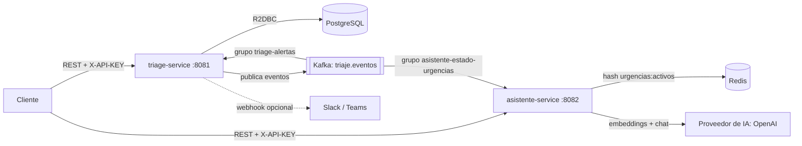

# VidaCruz: triaje digital con asistente clínico

Sistema backend (APIs + eventos) en **Java reactivo** compuesto por dos microservicios:

- **triage-service** (puerto 8081): registra pacientes, los clasifica con reglas clínicas objetivas (RN-01), controla el flujo de estados, vigila el SLA por nivel y escala automáticamente, con auditoría completa. También expone el reporte de operación y envía alertas al equipo médico.
- **asistente-service** (puerto 8082): responde preguntas sobre los protocolos clínicos internos con RAG y cita obligatoria de la fuente, y reconstruye el estado de las urgencias consumiendo Kafka.

## Arquitectura



Cada servicio sigue una arquitectura **hexagonal simplificada**: `domain` (reglas de negocio puras, sin frameworks), `application` (casos de uso) e `infraestructura` (REST, R2DBC, Kafka, Redis, IA). Las dependencias apuntan siempre hacia adentro.

Puntos clave:

- **Triage nunca depende del Asistente.** Solo publica eventos; si el Asistente está caído, triage sigue funcionando y el Asistente se pone al día al volver.
- **El Asistente no llama a la API de triage.** Reconstruye su vista leyendo el topic `triaje.eventos`.
- Sin llamadas bloqueantes en el event loop: lo bloqueante (Spring AI) corre en `boundedElastic`.

## Ejecución local (un solo comando)

Requisitos: Docker Desktop y una API key de OpenAI.

```bash
cp .env.example .env        # en PowerShell: Copy-Item .env.example .env
# edita .env: define API_KEY y OPENAI_API_KEY (POSTGRES_PASSWORD puede quedar como está)
docker compose up --build
```

Levanta PostgreSQL, Redis, Kafka y los dos servicios. Si falta `API_KEY` u `OPENAI_API_KEY`, Compose se detiene con un mensaje claro.

Para ver el escalamiento sin esperar decenas de minutos, descomenta en `.env` los SLA cortos (`SLA_CRITICO=1`, `ESCALAMIENTO_INTERVALO=10`, ...). El intervalo y los SLA son configurables; por defecto rigen los valores de la RN-02.

**Desarrollo desde el IDE:** `docker compose up -d postgres redis kafka` y arrancar cada servicio con el perfil `dev` (la API key de dev es `dev-key`; el asistente necesita `OPENAI_API_KEY` como variable de entorno).

### Prueba rápida

```bash
# Registrar un paciente (caso E1, debe clasificarse CRITICO)
curl -X POST http://localhost:8081/triage/pacientes \
  -H "X-API-KEY: $API_KEY" -H "Content-Type: application/json" \
  -d '{"nombre":"Juan Perez","edad":50,"frecuenciaCardiaca":130,"presionSistolica":180,
       "presionDiastolica":110,"spo2":97,"temperatura":36.8,"dolor":8,"gcs":15,
       "quejaPrincipal":"Dolor torácico"}'

# Estado de las urgencias (vista construida desde Kafka)
curl http://localhost:8082/asistente/estado-urgencias -H "X-API-KEY: $API_KEY"

# Consulta clínica con RAG
curl -X POST http://localhost:8082/asistente/consulta \
  -H "X-API-KEY: $API_KEY" -H "Content-Type: application/json" \
  -d '{"pregunta":"¿Cuáles son las medidas iniciales ante una crisis hipertensiva?"}'
```

## Endpoints

Todos exigen el header `X-API-KEY`, salvo `/actuator/health`.

| Servicio | Método y ruta | Descripción |
|---|---|---|
| triage | `POST /triage/pacientes` | Registra y clasifica (201). 400 si algún dato está fuera de rango |
| triage | `PATCH /triage/pacientes/{id}/estado` | Cambia de estado. 409 si la transición es inválida, 404 si no existe |
| triage | `GET /triage/pacientes/{id}` | Datos completos, flag de escalamiento y segundos en el estado actual |
| triage | `GET /triage/reportes/operacion?desde=&hasta=` | Reporte por hora (rango máximo 31 días) |
| asistente | `POST /asistente/consulta` | Respuesta con fuentes, o aviso de que no existe protocolo. 503 en modo degradado |
| asistente | `GET /asistente/estado-urgencias` | Pacientes activos por nivel |
| ambos | `GET /actuator/health` (+ `/readiness`, `/liveness`) | Probes de salud (sin autenticación) |
| ambos | `GET /actuator/prometheus` | Métricas |

Los errores comparten el formato `{ "status", "error", "detalles": [...] }`.

## Eventos Kafka

Topic `triaje.eventos`, mensajes JSON, **key = id del paciente** (así los eventos de un paciente llegan en orden).

```json
{
  "tipo": "paciente_registrado",
  "pacienteId": "6f1c2c7e-....",
  "nivel": "URGENTE",
  "estadoAnterior": null,
  "estadoNuevo": "REGISTRADO",
  "timestamp": "2026-11-28T15:30:00Z"
}
```

Tipos: `paciente_registrado`, `paciente_en_consulta`, `paciente_escalado`, `paciente_alta`. Todos llevan el `nivel` para que el Asistente cuente por nivel sin consultar a triage. En `paciente_escalado`, el estado anterior y el nuevo son ambos `REGISTRADO`: lo que cambia es el flag.

## Decisiones y supuestos

Decisiones de arquitectura en [`docs/adr`](docs/adr):

1. [Dos servicios e integración por Kafka](docs/adr/001-descomposicion-y-kafka.md)
2. [RAG, vector store y umbral de similitud](docs/adr/002-rag-y-vector-store.md)
3. [Alertas de escalamiento (RF-06)](docs/adr/003-alertas-de-escalamiento.md)
4. [Modo degradado y circuit breaker](docs/adr/004-modo-degradado.md)
5. [Despliegue en AKS](docs/adr/005-despliegue-aks.md)

Supuestos:

- **Quejas administrativas (nivel 5):** coincidencia exacta con la lista del enunciado, sin distinguir mayúsculas ni espacios sobrantes (las tildes sí cuentan). El nivel 5 solo aplica si ninguna condición de los niveles 1 a 3 se cumple.
- **Idempotencia del escalamiento (RN-03):** la garantiza la base de datos con un `UPDATE` condicional (`estado = 'REGISTRADO' AND escalado = false`). Marcar, auditar y publicar van en una transacción.
- **Auditoría (RN-04):** tabla `auditoria` que solo se escribe desde el servicio; no existe ningún endpoint que la modifique o borre.
- **Reporte (RF-05):** una sola consulta SQL (CTE, `ROW_NUMBER`, `COUNT ... FILTER`, `percentile_cont`). La espera solo se calcula para pacientes que entraron a consulta; los que salieron por alta directa o siguen esperando cuentan en el total y por nivel, pero no en el promedio ni en el p95. Las horas son UTC.
- **Mensaje de alertas:** solo id y nivel del paciente, sin datos personales ni clínicos.

## Observabilidad

- Probes de liveness y readiness en ambos servicios.
- Logs estructurados (formato ECS en el perfil `prod`) con `correlationId`. El header `X-Correlation-Id` se respeta si es válido o se genera, y vuelve en la respuesta.
- Métricas Micrometer: `triage_clasificaciones_total{nivel}`, `triage_escalamientos_total{nivel}`, `asistente_llm_latencia_seconds{resultado}`.

## Seguridad

- API key en el header `X-API-KEY`, comparada en tiempo constante, sin sesiones.
- Ninguna credencial en el repositorio: todo llega por variables de entorno (en Kubernetes, desde un `Secret` creado con `kubectl`). En el perfil `prod` no hay valores por defecto: si falta una variable, la aplicación no arranca.
- Validación de entradas con Bean Validation (rangos del enunciado, diastólica menor que sistólica, pregunta de hasta 500 caracteres).

## Tests

```bash
cd triage-service && ./mvnw test
cd asistente-service && ./mvnw test
```

Los tests de repositorio usan **Testcontainers** (PostgreSQL real), así que requieren Docker abierto. No necesitan ninguna API key: el proveedor de IA se reemplaza por un mock detrás de la interfaz `ClienteLlm`.

Cubren: clasificación de E1 a E6 y sus límites, transiciones válidas e inválidas, idempotencia del escalamiento (con mocks y con SQL real, incluido el caso de dos escalamientos simultáneos), citas del RAG, el caso "sin coincidencia sin alucinación", modo degradado y circuito abierto, API key, correlation id y mensaje de alertas.

## Despliegue en Azure

- **URL triage:** `http://<IP-TRIAGE>`
- **URL asistente:** `http://<IP-ASISTENTE>`
- **API key de revisión:** se entrega por separado.

Manifests en [`k8s/`](k8s): `00-infra.yaml` (PostgreSQL, Redis, Kafka), `10-triage.yaml` y `20-asistente.yaml` (Deployment, Service, probes, límites de memoria). Objetivo: AKS, con imágenes en Azure Container Registry. Los secretos se crean en el cluster con `kubectl create secret` y no están en el repositorio. Ver [ADR 005](docs/adr/005-despliegue-aks.md).

## Limitaciones conocidas y mejoras

- **Sin patrón Outbox:** el evento se publica dentro de la transacción. Si Kafka falla, se revierte el guardado; el caso inverso (Kafka confirma y falla el commit) es raro pero posible.
- **El correlation id no viaja en los eventos de Kafka.** No se puede seguir una operación de punta a punta entre servicios; el trazado distribuido (OpenTelemetry) lo resolvería.
- **Una sola API key compartida:** no identifica quién opera. El siguiente paso sería JWT con usuarios y roles.
- **HTTP sin TLS en el despliegue de prueba:** la key viaja sin cifrar. La mejora es un Ingress con certificado.
- **Datos no duraderos en el cluster:** PostgreSQL, Kafka y Redis corren como pods con almacenamiento efímero. En producción serían servicios administrados.
- **Umbral del RAG calibrado con una muestra pequeña** (los tres ejemplos del enunciado). Hay que revalidarlo si el corpus crece.
- **Las fuentes citadas son los fragmentos entregados como contexto**, no necesariamente cada uno de los que el modelo usó.
- **El corpus se vectoriza al arrancar el Asistente:** si el proveedor de IA falla en ese momento, el vector store queda vacío y el asistente responde "no existe protocolo" hasta reiniciar.
- La retención del topic de Kafka limita hasta dónde se puede reconstruir la vista de urgencias.

## Uso de herramientas de IA

Se usó un asistente de IA como apoyo durante el desarrollo. Las decisiones, supuestos y límites quedan documentados en los ADR y en este README.
